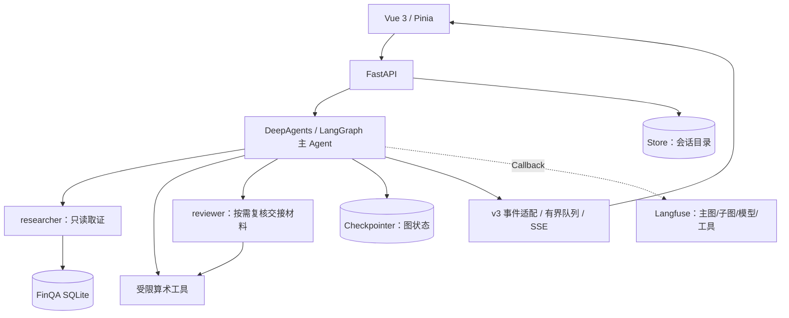

# 架构与设计取舍

本项目由 dubonline 围绕财报数据取证、计算与复核持续开发。以下说明当前实现，计划能力见路线图。

## 证据与计算

`app/repositories/finqa.py` 使用公司别名、年份筛选、受控指标别名和关键词检索，按指标行覆盖度优先排序。原始表头、行和期间单位说明一起返回，相同内容合并但保留全部来源。未使用向量数据库，也没有 PDF 导入解析。

我希望工具明确描述检索范围，而不是将单次未命中解释成全库缺失。当前证据是否充分仍需要模型判断，尚未以程序强制校验最终答案中的每个引用。

`app/tools/calculator.py` 使用字符和 AST 白名单执行有限算术，以 Decimal 运算。公式业务含义仍需核对；小数字面量经 Python AST 解析，不能宣传为任意精度金融计算引擎。

## 三角色职责

主 Agent 组织任务与汇总，researcher 通过只读工具取证，reviewer 只有计算工具，基于交接原始行、年份、单位和公式独立复算。分工可以减少上下文混杂，但 reviewer 不重新查库，仍可能依赖同一份错误证据。

复核调用按用户需求由提示词约束，未实现强制状态机。不同模型或不同实例也不构成正确性保证，单 Agent 与多 Agent 的质量、费用及延迟对照仍需评测。

## 状态、流式与取消

Checkpointer 保存图状态，Store 只保存会话目录、标题和预览，页面从实际图状态恢复消息。流式和最终答案通过消息 ID 对齐，减少重复结果；子 Agent 临时逐字过程不额外保存为页面快照。

有界队列控制缓冲，SSE 心跳维持空闲连接，停止信号传入图执行 abort。进程内限制同会话同时运行；不支持多 worker 之间共享占用或取消状态。停止也不保证撤回已发送的供应商请求或免除其费用。

## 追踪

`app/tracing.py` 共享 SDK 客户端，每轮请求独立 Trace 与 CallbackHandler，使用显式父 span 连接图执行，避免跨异步生成器保持请求级 OTel 当前上下文。追踪通过运行配置传递到子图与工具，并记录成功、取消、断连及错误终态。

默认不导出输入输出正文。显式开启后会遮蔽已知密钥字段与配置密钥，但不等于完整的业务数据脱敏。Token 依赖供应商 usage；成本由服务端模型价格计算，无用量或无价格时不伪造零费用。

请求不逐轮 flush；服务退出时在工作线程 shutdown。追踪故障不改变业务结果，目前没有持久化导出补偿与生产采集告警。

## 当前边界

当前是本地单用户、单进程应用。认证授权、多租户、完整财报解析、确定性证据校验、系统化质量评测和生产运维仍待实现。不要直接开放到公网，也不要仅增加 worker 数量来获取跨进程保护。
